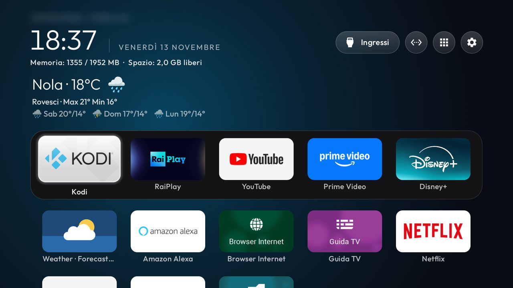

# myAndroidTvLauncher

Il mio fork di [CleanYourTV](https://github.com/Gathin23/cleanyourtv) di Gathin23, un launcher Android TV leggero
con temi e add-on. La licenza resta MIT ([LICENSE](LICENSE)); il README originale è in
[README.upstream.md](README.upstream.md) e le sue traduzioni (per esempio [README.it.md](README.it.md)) sono
rimaste come nel progetto originale.

Lo uso su una Philips 43PUS7354 (TP Vision TPM191E, Android TV 12, 2 GB di RAM), dopo aver disattivato con `adb`
le app superflue (`pm disable-user`, senza disinstallarle: tutto si riattiva con `tools/restore.sh`).

## Cosa ho aggiunto

- **Pannello meteo sulla Home**, sotto l'orologio, su tre righe:
  - città, temperatura attuale in °C e icona delle condizioni ("Nola · 18°C 🌧️");
  - descrizione in italiano con massima e minima di oggi ("Rovesci · Max 21° Min 16°");
  - previsione dei 3 giorni seguenti, ognuno con giorno abbreviato, icona e max/min ("Sab 20°/14°").

  

### Come funziona

- **Add-on Weather** (`addons/weather`, pacchetto `io.github.sumyabazar1.weather`): ha un content provider nuovo,
  di sola lettura, `content://io.github.sumyabazar1.weather.panel/forecast`, dichiarato con la meta-data
  `com.gathin.tvhome.weather`. Dà una riga per "adesso" e una per ciascuno dei 3 giorni seguenti.
  - Dati da [Open-Meteo](https://open-meteo.com), senza chiave; temperature in °C; testi nella lingua della TV.
  - Città: quella scelta nell'app Meteo; finché non se ne sceglie una, Nola.
  - Nessun servizio in background: quando il launcher chiede i dati e sono più vecchi di 30 minuti, l'add-on li
    riscarica in un thread e avvisa il launcher. Se il download fallisce riprova dopo 5 minuti.
  - Senza rete resta l'ultimo dato per 3 ore, poi il pannello sparisce.
- **Launcher** (`launcher/`): legge l'add-on come fa già con `game_day`, senza permesso `INTERNET`.
  - Chiave di tema `weather_panel`: il pacchetto dell'add-on. Vuota (il valore predefinito) = pannello spento.
  - Si richiede di nuovo i dati ogni 30 minuti con la Home aperta, e quando la Home torna in primo piano.
  - Se il pannello F1 (`race_calendar`) o Game Day (`game_day`) è visibile, ha la precedenza e il meteo si nasconde.
  - Spaziature regolabili in `WeatherPanel.java`: `WEATHER_GAP_TOP_DP` (14, spazio sopra il meteo) e
    `WEATHER_GAP_BOTTOM_DP` (24, spazio prima del dock, che si abbassa di altrettanto).

Per accenderlo, nel `config.json` del tema:

```json
"weather_panel": "io.github.sumyabazar1.weather"
```

### File toccati rispetto all'originale

| Dove | File |
|---|---|
| Add-on | `addons/weather/.../PanelProvider.java` e `Panel.java` (nuovi), `PanelTest.java` (nuovo), `AndroidManifest.xml`, `Forecast.java` (una riga) |
| Launcher | `WeatherPanel.java` e `WeatherPanelTest.java` (nuovi), `Config.java`, `MainActivity.java`, `res/values/config.xml`, `res/layout/activity_main.xml`, `res/layout-iw/activity_main.xml` |
| Documentazione | `docs/modules.md` (il contratto dei dati), `docs/switches.md` e `docs/switches/weather_panel.jpg`, `themes/README.md` |

## Compilare e installare

Compilo sempre con Docker, così la firma resta quella del volume `cleanyourtv-gradle` e gli aggiornamenti
non falliscono con `INSTALL_FAILED_UPDATE_INCOMPATIBLE` ([tools/docker-build.md](tools/docker-build.md)).
Al posto di `192.168.1.50` va l'indirizzo della propria TV.

```bash
tools/docker-build.sh addons/weather
tools/docker-build.sh launcher testReleaseUnitTest lintRelease assembleRelease

adb connect 192.168.1.50:5555
adb install -r addons/weather/app/build/outputs/apk/release/app-release.apk
SKIP_BUILD=1 HOME_KEY_SERVICE=1 TV_HOST=192.168.1.50 launcher/build-and-install.sh
TV_HOST=192.168.1.50 tools/theme.sh <cartella del tema>
```

Note:

- L'APK del launcher con il meteo pesa circa 590 KB, poco sopra il limite di 576 KB (589.824 B) che il progetto
  originale controlla nella CI. Sul mio fork non è un problema, ma la modifica non è pensata per un pull request
  verso l'originale.
- Avendo spostato il README originale, i test del repo che lo leggono (`tests/`, e la CI in
  `.github/workflows/ci.yml`) falliscono su questo fork.

## Restare allineato all'originale

Il ramo `origin` è il CleanYourTV ufficiale. Per prendere gli aggiornamenti:

```bash
git checkout meteo-pannello
git fetch origin
git rebase origin/main
```

Eventuali conflitti sono di solito in `MainActivity.java` o `Config.java`. Poi si ricompila con Docker.

## Crediti

Tutto il resto è il lavoro di [Gathin23 e dei contributori di CleanYourTV](https://github.com/Gathin23/cleanyourtv),
rilasciato con licenza MIT. L'add-on Weather è quello del progetto originale (`addons/weather`), a cui ho
aggiunto il provider per la Home.
